# 專案樹

最上面是這個 skill 成功的標準：**拿到的人不用問就能讓它動起來**。
往下每一層是「上面那個成立，要靠下面這些」。

- **綠**：自動檢查過了
- **紅**：還沒過，下面會寫卡在哪
- **黃**：只有人能判斷（好不好玩、看不看得懂），不假裝用程式測

**怎麼更新這棵樹**

```powershell
node checks/run.mjs
```

幾秒鐘，免費。要連回覆品質一起重測（幾分鐘，會用到你的 Claude 額度）：

```powershell
node checks/run.mjs --evals
```

**給 AI 的規則**：動手前先讀這棵樹；改完重跑一次，回報還有哪些紅、綠了幾成。壞掉時沿著線往下找，找到第一個紅的節點。

<!-- tree:start -->
**85% 綠**　自動檢查 17/20 過　·　3 項要人看　·　上次檢查 2026/11/26 04:29:43

**還是紅的**
- 別人拿到的就是這裡這一版：這些還沒推上 GitHub：.claude-plugin/marketplace.json、README.md、.claude-plugin/plugin.json
- 不用編號清單：沒過：no-numbered-lists 1/2
- 把一長串話整理好再請人確認：沒過：asks-to-confirm 0/1

**要人看**
- 在手機上一眼看得懂
- 第一次看的人看得懂
- 用起來有趣、讓人想再叫它

回覆項目用的是 2026/11/26 04:28:11 的回覆測試：有 skill 過了 85% 的評分項，沒有 skill 過了 46%。

```mermaid
graph TD
  root["拿到的人不用問就能讓它動起來"]:::red
  install["兩行指令就裝得起來"]:::red
  manifest["安裝設定檔格式正確"]:::green
  skillPath["安裝設定指到 skill 資料夾"]:::green
  realInstall["在乾淨的環境真的裝一次，skill 有出現"]:::green
  readmeCommands["說明書上的指令跟設定一致"]:::green
  pushed["別人拿到的就是這裡這一版"]:::red
  trigger["該出現的時候會自己出現"]:::green
  frontmatter["skill 名稱和說明格式正確"]:::green
  phrases["說明裡有觸發的關鍵句"]:::green
  content["AI 讀得到完整的思路"]:::green
  refs["提到的參考檔都在"]:::green
  short["主檔夠短，AI 一次讀完"]:::green
  patterns["行為 pattern 數量跟目錄一致"]:::green
  private["私人筆記沒有被帶出去"]:::green
  replies["回覆一眼看懂、照著就能做"]:::red
  language["用對方的語言和字體回"]:::green
  conclusion["第一行就是結論"]:::green
  oneProposal["一次只給一個提案"]:::green
  noNumbers["不用編號清單"]:::red
  whoServes["先說出是讓誰方便"]:::green
  userSide["站在使用者那邊找卡點"]:::green
  restate["把一長串話整理好再請人確認"]:::red
  phone["在手機上一眼看得懂"]:::person
  readme["打開 README 就知道是什麼"]:::green
  image["前後對照圖在"]:::green
  folders["資料夾說明跟實際檔案一致"]:::green
  firstLook["第一次看的人看得懂"]:::person
  fun["用起來有趣、讓人想再叫它"]:::person
  root --> install
  install --> manifest
  install --> skillPath
  install --> realInstall
  install --> readmeCommands
  install --> pushed
  root --> trigger
  trigger --> frontmatter
  trigger --> phrases
  root --> content
  content --> refs
  content --> short
  content --> patterns
  content --> private
  root --> replies
  replies --> language
  replies --> conclusion
  replies --> oneProposal
  replies --> noNumbers
  replies --> whoServes
  replies --> userSide
  replies --> restate
  replies --> phone
  root --> readme
  readme --> image
  readme --> folders
  readme --> firstLook
  root --> fun
  classDef green fill:#2e7d32,stroke:#1b5e20,color:#fff
  classDef red fill:#c62828,stroke:#8e0000,color:#fff
  classDef person fill:#f9a825,stroke:#c17900,color:#000
```


<!-- tree:end -->
