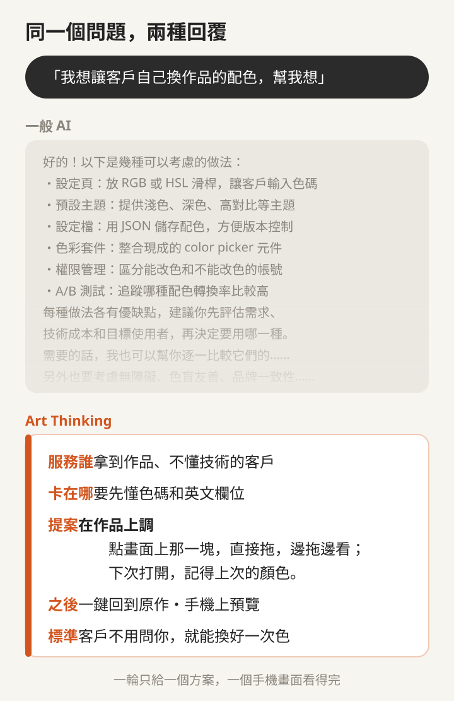

# Art Thinking

一個讓 AI 用藝術家的思維幫你想專案、檢視設計、寫程式、整理想法的 skill。

核心只有一個標準：**對方拿到之後，能不能不問我就讓它動起來？**



*English below.*

---

## 這是什麼

裝好之後，AI 會：
- 先問「這是讓誰方便、讓誰覺得好玩」，而不是先問「怎麼做得更快」
- 用你的招式產生點子（例如「把要填的變成自己找」「把限制變成亮度提示」）
- 一輪只給你一個具體方案，不丟一堆選項
- 用白話講，不用術語

## Skill 在哪

skill 放在 [thinking/](thinking/)，檔案本身是英文寫的，但會用你說話的語言回覆（簡體就回簡體，繁體就回繁體，英文就回英文）。

## 怎麼安裝

### Claude Code（推薦：用 plugin 安裝，會自動更新、每台電腦都一樣）
這個 repo 本身就是一個 Claude Code plugin marketplace。每台電腦只要在 PowerShell 跑一次：

```powershell
claude plugin marketplace add TseTseCheng/skill_Art-Thinking
claude plugin install art@art-thinking-skills
```

**打開自動更新**（第三方 marketplace 預設是關的）：在 Claude Code 裡打 `/plugin` → Marketplaces 分頁 → 選 `art-thinking-skills` → 開啟 auto-update。之後只要 push 到 GitHub，各台電腦開 Claude Code 時就會自己拉新版（每次 commit 都算新版本，不用改版號）。想馬上更新：

```powershell
claude plugin marketplace update art-thinking-skills
```

用 plugin 裝的話，指令會帶 plugin 名稱：`/art:thinking`。

以前裝過舊名字 `art-thinking-en` 的電腦，要先移除舊的再裝新的（改名不會自動接上）：

```powershell
claude plugin uninstall art-thinking-en@art-thinking-skills
```

### Claude Code（手動複製，不會自動更新）
把資料夾整個複製到你的個人 skill 資料夾：

```powershell
Copy-Item -Recurse "D:\Github\skill_Art-Thinking\thinking" "$env:USERPROFILE\.claude\skills\thinking"
```

只想在某個專案裡用的話，改複製到那個專案的 `.claude\skills\` 資料夾。

### claude.ai 網頁版或桌面 App 的聊天
1. 把 `thinking` 資料夾壓成 ZIP（資料夾名稱要跟 skill 名稱一樣）。
2. 打開 Customize → Skills → 「+」→ Upload a skill，上傳 ZIP。
3. 需要在 Settings → Capabilities 開啟程式碼執行。

注意：Claude Code、claude.ai、API 三邊的 skill 不會互相同步，要各自安裝。

## 怎麼用

有兩種方式叫它出來：
- **直接打指令**：`/art:thinking`（手動複製安裝的話是 `/thinking`），後面接你要說的話。
- **讓它自己判斷**：講到「用我的思維」「更有創造力」「客戶用不起來」「不知道意義」「整理我說的話」這類話時，AI 會自己用。

### 可以拿來做的事

| 想做什麼 | 你可以這樣說 | 它會做什麼 |
|----------|--------------|------------|
| **發想** | 「我想讓客戶可以自己換作品的配色，幫我想」 | 先整理你的話，找出對象和樂趣，用招式發散，最後給一個具體方案 |
| **檢視一個專案** | 「用我的思維看一下這個專案，客戶會卡在哪」 | 假裝自己是不懂技術的人，從拿到走到「動起來」，列出卡點，給一個改善提案 |
| **寫程式時做決定** | 「這個設定頁要怎麼做？」 | 自動找、記住上次的選擇、錯誤訊息用白話、直接在東西上調 |
| **找意義** | 「這個工具我不知道還要做什麼」 | 沿著作品往下游走，找出它保護的人或樂趣 |
| **跟 AI 講清楚** | 貼上一段語音輸入，說「整理我說的話」 | 修同音錯字、整理成每點開頭有名字的條列、分開你說的和它推測的，請你確認 |
| **寫交接文件** | 「整理成一份交接，我要給另一個 AI」 | 寫出包含出發點、否決過的版本、合作方式、判斷標準的交接文件 |
| **做一棵專案樹** | 「幫這個專案做一棵樹，看還有哪裡沒好」 | 從「成功建立在什麼之上」一路往下拆，存成一個 .md 加 Mermaid 圖，紅色是還沒完成、綠色是完成 |
| **檢查路線** | 「看一下這個 roadmap，好玩的東西還在嗎」 | 檢查嚴謹的工作有沒有吃掉當初讓人興奮的功能 |
| **決定要不要自己做** | 「要用現成的軟體，還是自己做？」 | 檢查別人的工具有沒有吃掉作品的細節、有沒有限制作品的呈現 |
| **寫動機文或論文的動機段落** | 「幫我寫這個專案為什麼要做」 | 用你的口吻和價值觀寫，不過度解讀 |
| **給團隊或外包的 AI 看** | 把 skill 放進專案的 `.claude/skills/` | 所有在這個專案工作的 AI 都會照同一套標準判斷 |

## 怎麼確認它是好的

[PROJECT_TREE.md](PROJECT_TREE.md) 是一棵樹：最上面是「拿到的人不用問就能讓它動起來」，往下拆成能檢查的小項目。綠色是過了，紅色寫著卡在哪，黃色是只有人能判斷的（好不好玩、看不看得懂）。

改完東西跑一次就會重新上色：

```powershell
node checks/run.mjs
```

連回覆品質一起重測（幾分鐘，會用到你的 Claude 額度；會同時跑有裝 skill 和沒裝 skill 的版本來比）：

```powershell
node checks/run.mjs --evals
```

## 資料夾內容

```
.claude-plugin/
  marketplace.json           plugin 安裝設定
  plugin.json                plugin 本身的名字和 skill 位置
PROJECT_TREE.md              專案樹：哪些過了、哪些還紅
checks/
  run.mjs                    跑全部檢查、幫樹上色
evals/                       回覆測試：真的問問題，看回覆有沒有照規則
  wedding-photo-review/      檢視一個流程
  voice-brief-clothing/      整理一長串語音輸入
  results/
    latest.json              最近一次回覆測試的結果
images/
  before-after.svg           README 最上面的前後對照圖
thinking/                    skill 本體
  SKILL.md                   主流程：一個標準、五種情境、回覆格式
  references/
    moves.md                 招式表：把 A 變成 B
    patterns.md              15 條行為 pattern 和例子
```

---

# English

A skill that lets an AI think like an artist: to brainstorm projects, review designs, make coding decisions, and turn rambling ideas into clear briefs.

One test drives everything: **can someone who receives the work get it moving without asking anyone?**

The picture at the top shows the difference: asked the same question, an ordinary AI lists many options; Art Thinking gives one proposal that fits on a phone screen.

The skill lives in `thinking/`. It is written in English and replies in whatever language the user writes in.

## Install

- **Claude Code (recommended, auto-updates across machines)**: this repo is a plugin marketplace. On each machine:
  ```
  claude plugin marketplace add TseTseCheng/skill_Art-Thinking
  claude plugin install art@art-thinking-skills
  ```
  Then turn on auto-update: `/plugin` → Marketplaces → `art-thinking-skills` → enable auto-update. Every push is picked up as a new version. Invoke it as `/art:thinking`.
- **Claude Code (manual, no updates)**: copy the folder to `~/.claude/skills/` (personal) or `<project>/.claude/skills/` (project only).
- **claude.ai / desktop chat**: zip the folder (folder name must match the skill name), then Customize → Skills → + → Upload a skill. Code execution must be enabled in Settings → Capabilities.
- Skills don't sync between Claude Code, claude.ai and the API; install on each.

## Is it working?

[PROJECT_TREE.md](PROJECT_TREE.md) is a tree of what success rests on, colored by automated checks (green = passes, red = says what's stuck, yellow = only a person can judge). Run `node checks/run.mjs` to recolor it; add `--evals` to also re-test real replies with and without the skill (a few minutes, uses your Claude account).

## What it's for

Ideation, reviewing a project from a non-technical user's point of view, coding defaults (discover instead of asking, remember choices, plain-language errors), finding the meaning in a purely technical project, organizing voice-typed ideas into a brief where every point is led by its name, writing handoff documents for another AI, keeping a project tree of what success rests on (red = not done, green = done), checking whether a roadmap still contains the fun parts, and deciding whether to build your own tool.
